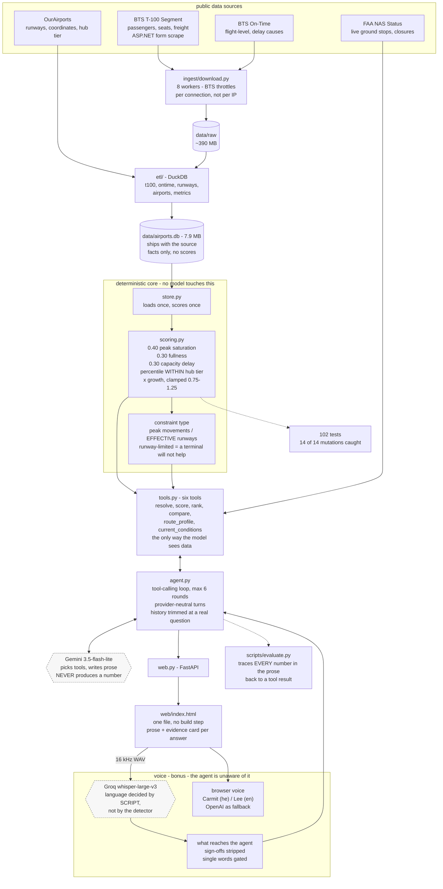

# Architecture

## What the arrows mean

**Solid** — data flowing through the system. **Dashed** — the checks that keep
it honest, which run outside a request.

The boundary that matters is the deterministic core. Everything inside it is
pure Python with no model in the path: the same snapshot produces byte-identical
scores on every load, verified three times over. The model sits to the right of
`tools.py` and can only ask questions of it.

Build time (`ingest` → `etl` → `airports.db`) runs once and is not part of
answering a question. That is
[ADR-0005](adr/0005-batch-snapshot-architecture.md): an analyst asking "rank New
England" needs all of them scored, not one, and percentiles are only meaningful
against the whole cohort.

Voice is drawn as a shell around the edges because that is exactly what it is
([ADR-0008](adr/0008-stack-and-interface.md)) — audio becomes text before the
agent sees it, and text becomes audio after it is done. The agent, the tools and
the scoring are unaware any of it exists, which is why the interface speaks
Hebrew without a single change to the core.
